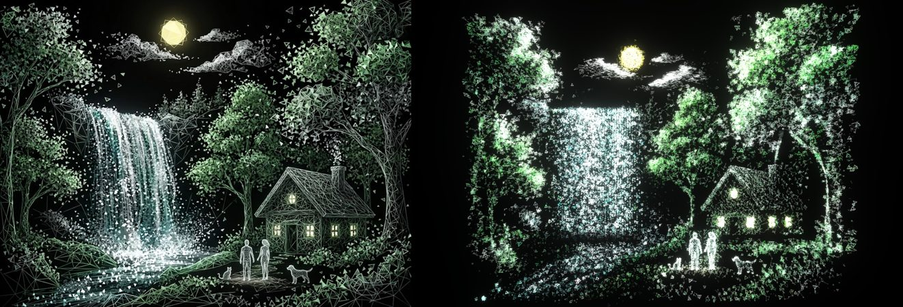

# Cena final — a cachoeira, a casa e o casal

Pedido de 24/10/2026: recriar [esta imagem](reference/finale/reference.webp) no campo de partículas, logo depois da Lia, encerrando o site com o desenho todo formado.



## Como foi feita

A cena é construída a partir dos próprios pixels da imagem. É a técnica C do plano bg3d que acompanhou a imagem: partículas derivadas dos pixels. Um desenho com milhares de traços não se reconstrói forma a forma, como o livro ou a árvore.

1. **Amostragem por traço.** O peso de cada pixel é `brilho^1.3 × (0.35 + 2.2·borda^0.8)`, então traços e marcas claras pesam mais que o preenchimento. Uma reamostragem sistemática ao longo da imagem distribui as partículas sem aglomerar (`finale/build.ts`).
2. **Regiões.** Cada região da imagem (`finale/regions.ts`, coordenadas lidas numa grade de 50 px) define:
   - profundidade;
   - movimento;
   - peso no orçamento;
   - brilho próprio;
   - tamanho de partícula;
   - linhas de luz.

   O casal e os bichos recebem partículas finas e peso 5×. A folhagem recebe triângulos grandes. Os troncos foram traçados à mão como polilinhas, porque são traços escuros que o brilho não pega.
3. **Movimento** (`finale/shaders.ts`, `sceneAnimate`):
   - a água cai pelos fios e recicla;
   - o rio corre para baixo e para a esquerda;
   - a fumaça sobe da chaminé;
   - as nuvens derivam;
   - as folhas balançam;
   - a lua, as janelas e o casal respiram luz.
4. **Duas camadas.**
   - As 16 384 partículas do campo (o prefixo embaralhado) chegam da Lia e desenham a cena inteira em versão grossa.
   - Uma camada de detalhe de 32 768 triângulos leves (6 triângulos cada, contra 48 da pirâmide; `finale/triangle.ts`) completa o desenho nos últimos 60% da formação.
   - Tudo nasce a partir do casal: o rank de chegada é a distância até eles.
5. **Celular.** A imagem mantém a altura e a câmera atravessa o quadro devagar (40 s, ida e volta), em vez de encolher a cena.

A profundidade das regiões foi reduzida à metade, para a cena se ler como um quadro, com parallax leve.

## No site

- **Coreografia:**
  - a Lia se forma na seção dela (f 12,5–13,05) e fica sozinha até f 13,6;
  - entre 13,6 e 14,0, já no contato, o campo vira a cena (forma 9, `FORM.finale`) e se centraliza;
  - a camada de detalhe completa o desenho de 13,8 a 14,0 (`pose.detail`);
  - o site termina com o desenho formado.
- **Campo** (`forms/finale.ts`): as primeiras 16 384 partículas da cena, um prefixo embaralhado que cobre o quadro todo, entram no `forms.bin`.
  - Com 10 formas, o atlas passa a 4×4.
  - Os movimentos (água, rio, fumaça, nuvens, brilho) estão em `MOTION` (14–18). `sceneAnimate` é chamado pelo `animate` do shader de alvo, e alfa e brilho pela passada de look.
  - O tamanho por região viaja em `motion.w` (tamanho ÷ 2) e o vértice das partículas o aplica.
- **Camada de detalhe** (`finale/layer.ts`): carrega `public/particles/finale.bin` depois do campo, sem bloquear nada.
  - Formato quantizado FIN3, com 1,2 MB.
  - Desenha os 32 768 triângulos e as linhas que tocam neles, com a mesma rotação, posição e escala do campo.
  - Telas menores desenham um prefixo: 24 000 no tablet e 14 000 no celular.
- **Celular:** a cena fica com fator 3,4 em vez de 3,0 (`FINALE_MOBILE_ZOOM`), e o renderer atravessa o quadro em 40 s.

## Rodar

```sh
npm run particles     # forms.bin (10 formas) e finale.bin (cena + detalhe)
npm run finale        # só finale.bin, para iterar na cena
npm run dev:vite      # prévia isolada: http://localhost:5173/finale.html
```

No site, `?f=14` fixa o campo na cena formada. Na prévia isolada, `?formed=1` começa com a cena formada. `node scripts/capture-finale.mts <pasta>` captura a prévia, e `node scripts/capture-forms.mts <pasta> 13.3,13.85,14 <url>` captura o site fixado.

## Limites

São 49 152 partículas e cerca de 40 mil linhas, contra dezenas de milhares de traços na imagem gerada. A cachoeira ainda é uma cortina mais larga e reta que a da referência, e a árvore da esquerda tem menos tronco visível. Os arquivos somam 2,7 MB (`forms.bin`) e 1,2 MB (`finale.bin`) antes da compressão do servidor.
